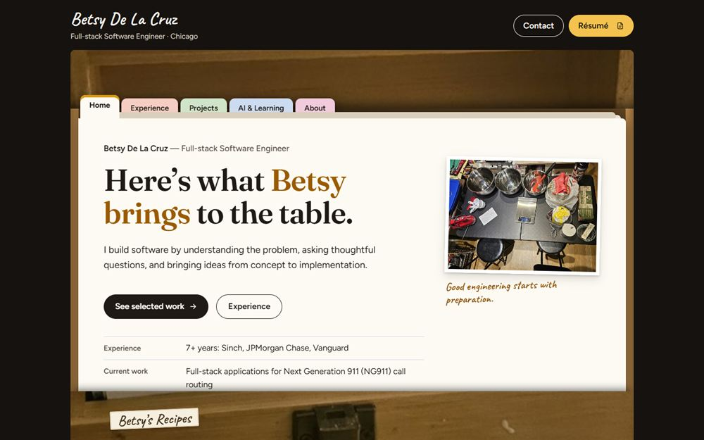

# 🎡 Reasons to Hire Betsy

Welcome to **Reasons to Hire Betsy**, Betsy De La Cruz's software engineering portfolio. Since v2.0 the homepage is Betsy's own wooden recipe box: open it, and her experience, projects, AI work and story are the index cards inside. The original Magic 8-Ball lives on as one of the projects, with its own page at `/apps/magic-8-ball/`.



How v2.0 was designed and built: [DESIGN.md](DESIGN.md), [docs/decisions/](docs/decisions/) and [docs/research/](docs/research/).

🔗 **Live Site**: [https://reasonstohirebetsy.com](https://reasonstohirebetsy.com)  
📘 **Swagger Docs**: [https://reasonstohirebetsy.onrender.com/swagger-ui/index.html](https://reasonstohirebetsy.onrender.com/swagger-ui/index.html)

---

## 🚀 Tech Stack

### Frontend (Vite multi-page build)
- `/`: the recipe-box portfolio, in plain HTML, CSS and JavaScript (`frontend/index.html`, `frontend/src/portfolio/`). Hash routes (`#/projects`, `#/projects/magic-8-ball`, …) need no server rewrites.
- `/apps/magic-8-ball/`: the standalone Magic 8-Ball, in React and TypeScript (`frontend/apps/`, `frontend/src/apps/magic-8-ball/`), with the original cartoon illustration of Betsy and her dogs and local fallback reasons
- Vitest tests for the 8-Ball's reason handling (`npm test`)
- Environment-based API switching (local vs production)

### Backend (Spring Boot)
- Spring Boot with PostgreSQL
- RESTful API that serves a random reason from the DB
- Swagger UI for endpoint testing and demonstration
- Flyway for production-safe DB migrations
- Environment variables for DB credentials and Cloudinary integration

### Deployment
- Frontend: Vercel
- Backend: Render (Java Web Service)

---

## 📂 Features

### Magic 8-Ball Mechanics
- Each time you press "Shake the Magic 8-Ball", an affirmation like *"Yes, yes, YES!"* is shown followed by a professional or personal reason to hire Betsy.
- Reasons come with emoji-coded categories: TECHNICAL, PERSONALITY, SOFT_SKILL, BETSY_ENERGY, and more.

### Developer Showcase
- Swagger UI exposes all backend endpoints
- Flyway migrations ensure clean production upgrades
- Code split into `frontend/` and `backend/` modules

---

## 🪧 Setup & Local Development

### 1. Backend Setup
```bash
cd backend
cp .env.template .env  # populate secrets for DB + Cloudinary
npm install -g env-cmd  # if needed
env-cmd -f .env mvn spring-boot:run
```

### 2. Frontend Setup
```bash
cd frontend
cp .env.local.template .env.local  # set VITE_API_URL=http://localhost:8080
npm install
npm run dev
```

The dev server prints its URL (normally `http://localhost:5173`). It serves:
- `/`: the recipe-box portfolio
- `/apps/magic-8-ball/`: the standalone Magic 8-Ball
- `/explorations/v2-recipe-index/` and `/explorations/v2-recipe-box/`: archived design prototypes (development only, never in the production build; run each folder's `make-photos.ps1` first, which needs the git-ignored originals)

Other commands, all in `frontend/`: `npm test` (Vitest), `npm run lint`, `npm run build` (output in `dist/`), `npm run preview` (serves the build locally).

The portfolio's photos are committed, metadata-free web copies in `frontend/src/portfolio/photos/`. Betsy's original photos are never committed.

---

## ❌ Common Errors + Workarounds

### Tailwind not working in Vite
- Caused by incorrect PostCSS plugin setup.
```js
// postcss.config.js
import tailwindcss from 'tailwindcss';
import autoprefixer from 'autoprefixer';
export default { plugins: [tailwindcss, autoprefixer] };
```

### Spring Boot fails with missing main class
- Fixed by adding `mainClass` to `spring-boot-maven-plugin` in `backend/pom.xml`

### Flyway Errors
- Column already exists → drop the column or increment Flyway version
- No schema history table → add `baselineOnMigrate: true`

### Frontend build fails on Vercel
- Caused by missing image assets or Rollup bug
- Fixed by restoring image paths and reinstalling dependencies

### CORS error
- Resolved via Spring `CorsConfig`:
```java
.allowedOriginPatterns("https://reasons-to-hire-betsy.vercel.app", "http://localhost:5173")
```

### Render: `mvn` not found
- Switched to Docker-based deployment or custom Maven installation

---

## 🧰 What You Can Show Off

- Modern frontend with Vite + Tailwind
- Spring Boot backend with Swagger UI
- Clean API separation using services + repositories
- Flyway database versioning
- Deployment with environment-based configs
- A delightful UX with interactive magic 8-ball vibes

---

## 🥇 Next Steps
- Add observability with Honeycomb
- Admin panel to approve/reject submitted reasons
- Dark mode toggle
- User-submitted reasons

---

## ✨ Final Result
This app is a personal and technical portfolio brought to life. It combines Betsy's story, backend engineering skills, and a joyful user interface to answer:  
**"Is Betsy your next great hire?"** — *Signs point to YES.*

